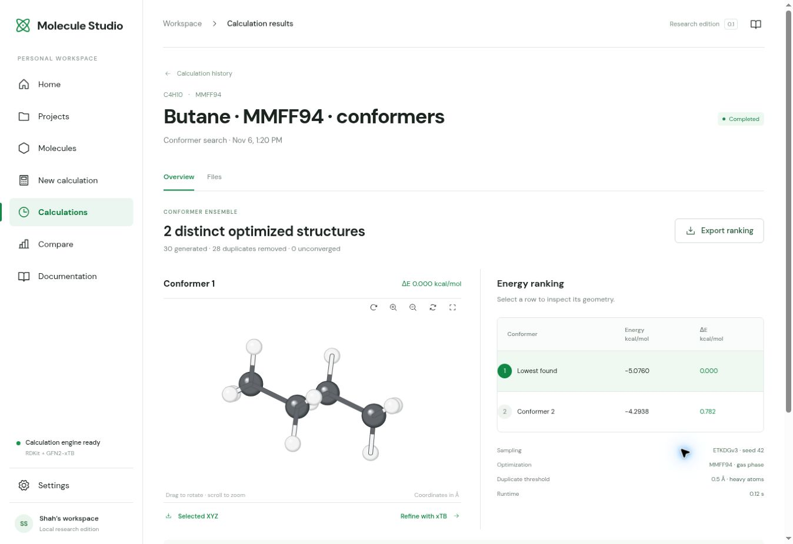

# Molecule Studio

### Draw a molecule. Find its shapes. Explore what changes.

An open-source molecular workbench that connects a 2D sketch to real calculations and interactive 3D results. No paid chemistry API or API key.



**Try a question:** How many different shapes can butane adopt? Search its conformers, compare their energies, then refine a selected shape with GFN2-xTB.

- **Build** — draw structures or import SMILES, MOL/SDF and XYZ.
- **Calculate** — RDKit descriptors, MMFF94/UFF optimization and GFN2-xTB energies, charges and dipoles.
- **Compare** — inspect 3D conformers and rank calculated relative energies.
- **Keep your work** — export XYZ, SDF, JSON and CSV.

### Run it

With Python 3.12+ and Node.js 22+, from the project folder:

```bash
python3 launch.py
```

### Host a free demo

[Deploy frontend + backend on Render](https://render.com/deploy?repo=https://github.com/sha786muhammed/molecule-studio) · [Setup & free-plan limits](docs/DEPLOYMENT.md)

One free service runs both. It sleeps when idle; demo workspaces are temporary. Deployment requires your Render sign-in.

Early research prototype. GFN2-xTB is semiempirical, not DFT; conformer sampling is bounded.

[Quick start](docs/QUICKSTART.md) · [Scientific examples](examples/README.md) · [Methods](docs/METHODS.md) · [Validation](docs/VALIDATION.md) · [Contribute](CONTRIBUTING.md) · [MIT](LICENSE)
