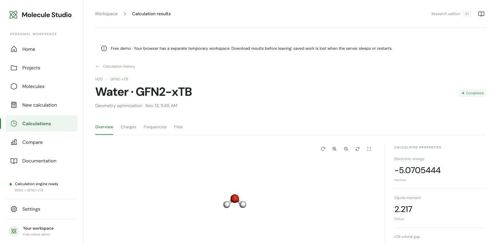

# Verification records

## Live free deployment — 13 November 2026

[Open Molecule Studio](https://molecule-studio.onrender.com). Render deployed commit `8fe82e31d02d02ed2eecba9c8890d207d01ec47f` on a Docker **Free** instance, serving the React frontend and Python backend together.

A calculation was submitted through the public website: water, GFN2-xTB, gas phase, charge 0, multiplicity 1, geometry optimization with numerical frequencies. It completed and reported convergence in 8.29 seconds. Electronic energy: −5.0705444 Hartree; dipole: 2.217 Debye; internal frequencies: 1538.71, 3643.31 and 3651.73 cm⁻¹. The XYZ download completed successfully. This is a specific computational smoke check, not a performance benchmark or experimental validation.

The Home, Projects, Molecules, New calculation, Calculations, Results, Compare, Documentation and Settings pages were opened without application error alerts. This checks page access, not every possible interaction.

The source passed [GitHub validation](https://github.com/sha786muhammed/molecule-studio/actions/runs/43457930919): 24 Python tests, 6 JavaScript tests, the local scientific examples, container build, and hosted HTTP smoke check with 512 MB RAM and 0.1 CPU.

Saved demo work remains temporary: export it before the free instance sleeps or restarts. Each visitor receives a separate browser workspace; this result is not a globally shared job.

## Free-demo preparation — 13 November 2026

- Production frontend build passed. The existing large-JavaScript-bundle warning remains.
- 24 Python tests and 6 JavaScript tests passed. The four Sites packaging checks are included in the JavaScript suite.
- Six hosted integration tests cover separate browser workspaces, access to local data, real background xTB and XYZ export, cross-visitor job/export denial, modified and expired cookies, cross-origin writes, per-workspace quotas, and the shared queue limit.
- The hosted ASGI entry point was started through uvicorn and checked over HTTP: built frontend, real water GFN2-xTB single point, XYZ download and a second visitor's access denial all passed.
- The unchanged local launch workflow and three scientific examples were checked again through `scripts/smoke_local.py`.
- Docker is unavailable in the editing environment. The GitHub workflow now builds the actual container and runs `scripts/smoke_hosted.py` with a 512 MB memory cap and 0.1 CPU. Consult its run result before claiming the container build passed.
- A public website is not deployed by committing deployment configuration. Render sign-in, a successful provider build and a live calculation are required.

## Local release verification — 11 November 2026

## Environment

- Linux x86_64, glibc 2.41; Python 3.12.14; Node.js 24.22.1.
- RDKit 2026.09.1, tblite 0.8.0, ASE 3.29.0.
- Created a fresh project-local virtual environment with `python launch.py --setup-only`. The launcher downloaded and installed dependencies, ran `npm ci`, and completed the production build without using the earlier workspace's scientific packages.
- macOS and Windows setup paths are documented, but neither platform has been independently verified. Node.js 22 is the configured CI target; this local run used Node.js 24.

## Checks performed

| Check | Result |
|---|---|
| Python suite | 18 tests passed |
| JavaScript suite | 6 tests passed |
| Sites packaging check | 4 tests passed; these are a subset of the JavaScript suite |
| Production frontend build | Passed; retains the existing large-JavaScript-bundle warning |
| Fresh installation | Passed with scientific dependencies isolated in `.venv` |
| Launcher from outside the project directory | Passed |
| Built frontend plus API in one loopback process | Passed through HTTP |
| Missing API route and non-public project-file requests | Correctly returned 404 |
| Separate temporary scientific database | Created and used correctly |
| Scientific example runner | Water, ethanol and butane passed |
| XYZ/SDF/JSON example outputs | Generated by the real local server |
| Launcher/server shutdown | Completed; server no longer answered HTTP requests |

The reusable integration command is `python scripts/smoke_local.py`. It starts the actual launcher from a different working directory, uses a temporary database, runs the examples and stops the application. See `examples/reference-results.json` for measured results and engine versions.

The first JavaScript verification attempt overlapped a frontend rebuild and encountered a missing generated `dist/client/index.html`. After the build completed, all checks passed. The GitHub workflow and README now build before testing the generated packaging files so the same ordering works in a clean checkout.

## Scientific examples

| Example | Measured result |
|---|---|
| GFN2-xTB optimized water | Energy −5.07054444499 Hartree; dipole 2.21712 Debye; internal frequencies 1538.71, 3643.31, 3651.73 cm⁻¹ |
| MMFF94 optimized ethanol | Energy −1.33685706194 kcal/mol; converged |
| Butane conformer search | 30 candidates; 2 distinct optimized structures; relative energies 0.000 and 0.782209 kcal/mol |

These are computational checks on specific molecules. They do not establish experimental agreement, exhaustive conformational coverage, or general validation of every supported input.

## Remaining limits

- A new visual browser check could not reach this workspace's preview through the available browser connections. No new browser-rendering claim is made for this packaging update; the frontend files are unchanged. The built HTML/API integration was checked directly through HTTP.
- This historical local run preceded publication. The repository was published on 12 November; its initial GitHub validation [passed](https://github.com/sha786muhammed/molecule-studio/actions/runs/43278564097).
- The local edition remains single-user. The later hosted demo adds temporary isolated browser workspaces, not authenticated accounts or durable hosted storage.
- Upstream ASE/NumPy and FastAPI deprecation warnings remain; they did not prevent the recorded checks from passing.
